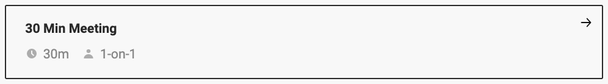

<h1 align="left">I'm Ahmad Aghazadeh. </h1>

## Local professional website

This repository also contains a Next.js App Router website built with TypeScript
and Tailwind CSS. The original profile README continues below this section.

### Run on Windows / PowerShell

Requires Node.js 20.9 or newer and npm. From this repository:

```powershell
npm.cmd ci
npm.cmd run dev
```

Open the **Local** URL printed by the server. The launcher binds only to
`127.0.0.1`, tries port 3000, and automatically skips occupied or Windows-reserved
ports. On the development machine, port 3000 is reserved and the site runs at
`http://127.0.0.1:3001`.

To choose a different starting port:

```powershell
$env:PORT = '4000'
npm.cmd run dev
```

Stop the server with Ctrl+C. For a production build and local production server:

```powershell
npm.cmd run typecheck
npm.cmd run build
npm.cmd start
```

Fonts, the system illustration, favicon, and generated social image are served
locally. There are no runtime analytics, external font requests, database, or
contact-form services. Social links open external sites; email links open your
configured email client.

### Update content

- Edit `src/content/profile.ts` for biography, contact links, career history,
  expertise, and work highlights. `Profile.pdf` is the primary editorial source;
  the older resume is preserved but is not offered as a website download.
- To add a portfolio link, set `caseStudyUrl` on a work highlight. The link is
  rendered only when a URL is provided; no placeholder links are shown.
- Edit `src/app/globals.css` for the visual design. Fonts are installed through
  `@fontsource-variable` and bundled with the application.
- Metadata is in `src/app/layout.tsx`; the social image is generated by
  `src/app/opengraph-image.tsx`. The development launcher sets
  `NEXT_PUBLIC_SITE_URL` to the selected local address. Production metadata
  defaults to `http://127.0.0.1:3001`; if using another production port, set
  `NEXT_PUBLIC_SITE_URL` to that address **before** `npm.cmd run build`.

### Verification

The site supports mobile, tablet, and desktop layouts, keyboard navigation,
Escape-to-close mobile navigation, visible focus indicators, and reduced motion.
Run `npm.cmd run typecheck` and `npm.cmd run build` after changes, then review
the affected layout in the browser.

---

<p>
Results-oriented Software Engineer with over 14 years of professional experience specializing in backend development and integration with the front end. Committed to collaborative problem-solving, critical thinking, and the creation of high-quality products. With a strong focus on Clean Code, Scrum, Clean Architecture, TDD, BDD, DDD, Microservices, and creating scalable solutions. Experienced in training and guiding staff, conducting code reviews, and staying updated with emerging technologies.

</p>
<p align="left">
 <a href="https://linkedin.com/in/AhmadAghazadeh" target="_blank">
  
 </a>
</p>


 <a href="https://github.com/ahmadaghazadeh" target="_blank">
  
 </a>

 Pick a slot if you'd like to meet me and chat about anything you are passionate about - but make sure to describe the agenda

 <a href="https://calendly.com/ahmad-aghazadeh-a/wallester" target="_blank"></a>


<p align="left">
 <strong>
   Professional skills
  </strong>
</p>

<p align="left">
  
  
  
  
  
</p>
</br>
<p align="left">
 <a href="#" alt="Ahmad Aghazadeh's github stats">
  
 </a>
</p>

<p align="left">
 <a href="https://stackoverflow.com/users/1770868/ahmad-aghazadeh" alt="Ahmad Aghazadeh's Stackoverflow stats">
 </a>
</p>


<p align="left">
 <a href="https://www.buymeacoffee.com/AhmadAghazadeh" target="_blank">
  
 </a>
</p>
